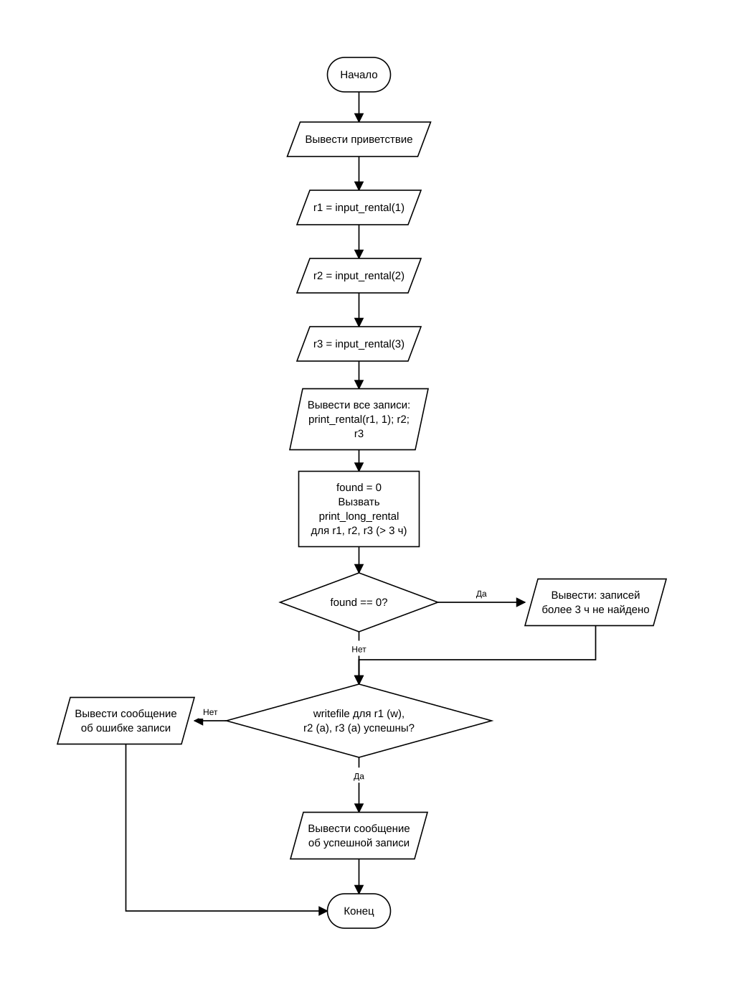

# Домашнее задание к работе 12

## Условие задачи (Вариант 2)

Доработать программу из домашнего задания к работе 11 (структура для хранения записи «Прокат велосипеда»), добавив функцию записи массива структур в текстовый файл.

Поля записи:
- номер велосипеда;
- тип велосипеда;
- стоимость аренды за час;
- время начала аренды;
- время окончания аренды.

Требования:
1. Ввести с клавиатуры данные для трех записей проката.
2. Вычислить продолжительность и стоимость каждой аренды (с учетом возможного перехода через полночь), вывести все записи, а также записи с длительностью более 3 часов.
3. Реализовать функцию `writefile`, которая открывает файл `rentals.txt` для записи, проверяет успешность открытия, записывает поля каждой структуры (с разделителями-пробелами после строковых значений и переводом строки в конце каждой записи) и закрывает файл.

---

## 1. Алгоритм и блок-схема

### Алгоритм

1. Задать константы: количество записей `COUNT = 3`, порог длительности `LIMIT_HOURS = 3.0`, переводные константы времени и имя выходного файла `FILENAME = "rentals.txt"`.
2. Описать структуру `Time` (часы и минуты) и структуру `BikeRental` со всеми полями записи проката.
3. Настроить локализацию (`setlocale`) для корректной работы с русским языком в консоли.
4. В цикле от 0 до 2 считать с клавиатуры данные для 3 записей проката: номер велосипеда, тип (одно слово без пробелов), тариф, время начала и время окончания.
5. Вызвать функцию `process_rentals`:
   - для каждой записи рассчитать длительность проката через `calculate_duration` (при переходе через полночь прибавить 24 часа) и стоимость аренды;
   - вывести на экран все 3 записи;
   - отдельно вывести записи, у которых продолжительность превышает 3 часа (или сообщение, если таких записей нет).
6. Вызвать функцию `writefile(FILENAME, rentals, COUNT)`:
   - открыть файл `rentals.txt` в режиме записи `"w"`; если указатель `out == NULL`, вывести сообщение об ошибке и вернуть `0`;
   - в цикле по всем записям рассчитать `duration` и `cost` и записать в файл строку с полями структуры через `fprintf` (после `%s` ставится пробел перед разделителем `;`, строка завершается `\n`);
   - закрыть файл функцией `fclose` и вернуть `1` при успешном закрытии.
7. По результату `writefile` вывести сообщение об успешном сохранении данных в файл или об ошибке и завершить программу.

### Блок-схема



*Исходник схемы для draw.io: [Lab12_AlgSchema.drawio](Lab12_AlgSchema.drawio)*

---

## 2. Реализация программы

Исходный код программы: [Source.c](Source.c)

---

## 3. Результаты работы программы

Пример диалога в консоли при вводе 3 записей:

```
Программа учета проката велосипедов с записью в файл

Ввод данных для записи 1:
Введите номер велосипеда: 101
Введите тип велосипеда (без пробелов): Горный
Введите стоимость аренды за час (руб): 250
Введите время начала аренды (часы и минуты): 10 00
Введите время окончания аренды (часы и минуты): 14 30

Ввод данных для записи 2:
Введите номер велосипеда: 102
Введите тип велосипеда (без пробелов): Городской
Введите стоимость аренды за час (руб): 150
Введите время начала аренды (часы и минуты): 16 00
Введите время окончания аренды (часы и минуты): 18 15

Ввод данных для записи 3:
Введите номер велосипеда: 103
Введите тип велосипеда (без пробелов): Шоссейный
Введите стоимость аренды за час (руб): 300
Введите время начала аренды (часы и минуты): 22 00
Введите время окончания аренды (часы и минуты): 1 45

Все записи проката

Запись 1:
  Номер велосипеда: 101
  Тип: Горный
  Тариф: 250,00 руб/ч
  Время аренды: 10:00 - 14:30
  Продолжительность: 4,50 ч
  Стоимость: 1125,00 руб

Запись 2:
  Номер велосипеда: 102
  Тип: Городской
  Тариф: 150,00 руб/ч
  Время аренды: 16:00 - 18:15
  Продолжительность: 2,25 ч
  Стоимость: 337,50 руб

Запись 3:
  Номер велосипеда: 103
  Тип: Шоссейный
  Тариф: 300,00 руб/ч
  Время аренды: 22:00 - 01:45
  Продолжительность: 3,75 ч
  Стоимость: 1125,00 руб

Записи с продолжительностью аренды более 3 часов

Запись 1:
  Номер велосипеда: 101
  Тип: Горный
  Тариф: 250,00 руб/ч
  Время аренды: 10:00 - 14:30
  Продолжительность: 4,50 ч
  Стоимость: 1125,00 руб

Запись 3:
  Номер велосипеда: 103
  Тип: Шоссейный
  Тариф: 300,00 руб/ч
  Время аренды: 22:00 - 01:45
  Продолжительность: 3,75 ч
  Стоимость: 1125,00 руб

Данные успешно записаны в файл rentals.txt
```

Содержимое сформированного файла `rentals.txt`:

```
Номер:101 ; Тип:              Горный ; Тариф:250,00 ; Начало:10:00 ; Окончание:14:30 ; Продолжительность:4,50 ; Стоимость:1125,00
Номер:102 ; Тип:           Городской ; Тариф:150,00 ; Начало:16:00 ; Окончание:18:15 ; Продолжительность:2,25 ; Стоимость:337,50
Номер:103 ; Тип:           Шоссейный ; Тариф:300,00 ; Начало:22:00 ; Окончание:01:45 ; Продолжительность:3,75 ; Стоимость:1125,00
```

---

## 4. Информация о разработчике

- **ФИО:** Аносов Сергей Юрьевич
- **Группа:** бОТИ-261
